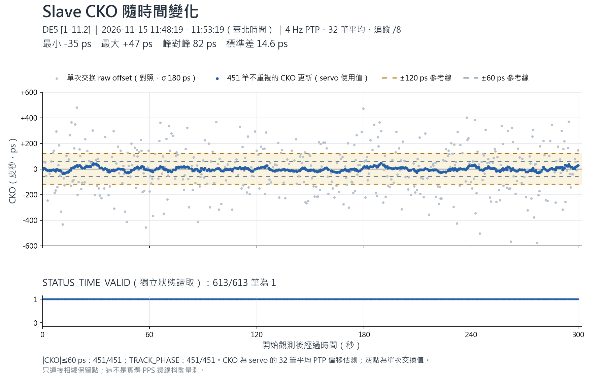
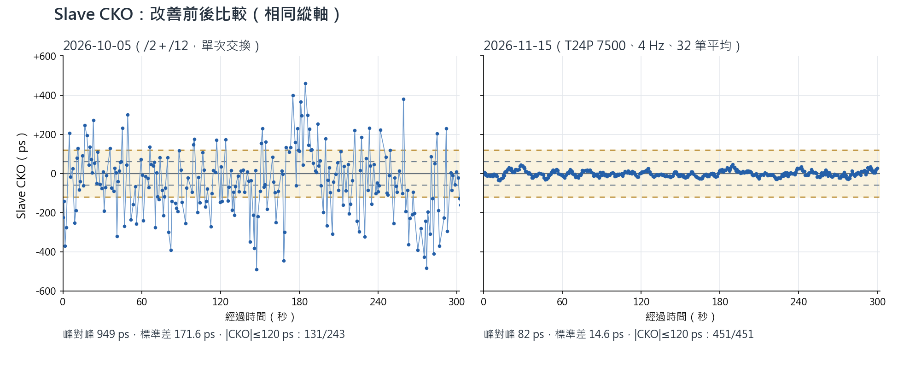
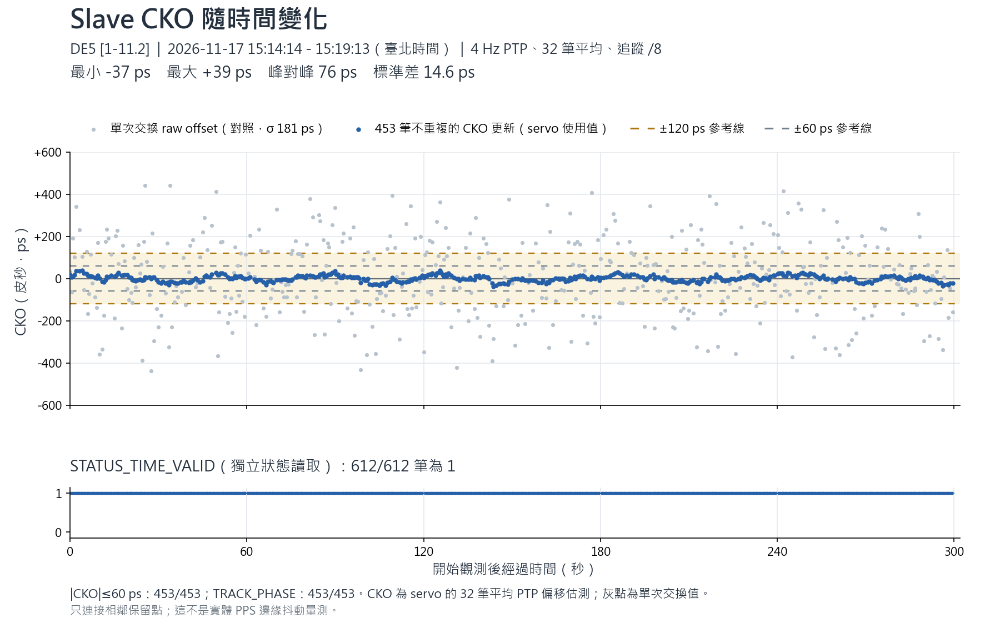

# EXP-S7-TIMING-CLOSURE-SDC-20261115 實驗報告

## 結論
**PASS：兩個設計 `TIMING_CLOSED=YES`，且 TIME_VALID 300 s 與 CKO 嚴格保持在新 compile／新開機下重現通過。**

### 時序（TimeQuest，所有 corner 最差值）
| 設計 | setup | hold | recovery | removal | TIMING_CLOSED |
|---|---:|---:|---:|---:|---|
| Master | 0.194 或 0.267 ns | 0.034 或 0.035 ns | 0.467 或 0.526 ns | 0.293 或 0.297 ns | **YES** |
| Slave | 同上兩組數值之一 | | | | **YES** |

（`build_info_{master,slave}.txt` 各有兩份紀錄，兩設計的最差值落在上列兩組數字；全部 >0。前一輪 Master removal −0.219 ns、Slave −0.187 ns。）
仍有 `UNCONSTRAINED_CLOCKS=5`（Si5340 I2C 除頻時脈、DMTD sampler 偵錯計數器的 clk_in、CPU_RESET_n latch 等），
以及未約束的 I/O 路徑；這些不影響上述 slack，但代表仍有節點未被時序分析，列為後續可清理項目。

### 功能重新驗證
| 項目 | 結果 |
|---|---|
| TIME_VALID 300 s | PASS（`verify_time_valid_300s.sh` exit 0） |
| 濾波 CKO | −35..+34 ps，σ 13.1 ps |
| \|CKO\|≤60 ps／TRACK | 454/454／454/454 |
| 最長嚴格保持 | **299.2 s（PASS_CKO_HOLD，目標 120 s）** |
| raw 單次交換 offset | −619..+635 ps，σ 191.3 ps |

證據：`raw/cko/20261115T032544Z-cko.log`、`analysis/20261115T032544Z-cko-hold.json`、`raw/build/`、`raw/pipeline/pipeline.log`。

### SOF SHA-256
- Master：`2383986878121687965f96e18b2d1d5de959b25fd4de0cdadd73e2b7778b2e64`
- Slave：`913ffea9b7c91aff3b1e75e6d1ae86502093f5acdf1a58eb74b8669f9f9e1d2c`

## 本分支四輪摘要（exp/step7-main-revalidation-20261115）
| 輪 | 變更 | CKO 範圍 | 最長嚴格保持 | 時序 |
|---|---|---|---:|---|
| 1 | main 原樣重燒 | −2521..+3799 ps（30 次 8 ns 跳變） | 0 s | NO |
| 2 | Master T24P 2389→7500 | −540..+503 ps（0 跳變） | 8.9 s | NO |
| 3 | 4 Hz PTP、servo 32 筆平均 | −40..+41 ps | 299.9 s | NO |
| 4 | SDC：DMTD 約束＋非同步重置例外 | −35..+34 ps | 299.2 s | **YES** |

## 限制
- CKO 是 servo 的 PTP 偏移估測（32 筆平均），**不是實體 PPS 邊緣量測**；單次交換噪聲（σ≈190 ps）仍存在，
  根因（兩板 RX 時間戳記 fine phase 每封包噪聲）尚未消除。實體 ±60/120 ps 仍需示波器或時間間隔計數器驗證。
- Master T24P 7500 是依 Slave 實測推得，不是 Master 本身掃描值。
- 兩次 PASS 皆為同一實驗室環境、同日；冷開機與長時間（數小時）穩定性尚未驗證。

## 追加量測（2026-11-15 11:48–11:53，使用者關閉儀表板後）
同一燒錄狀態再擷取 300 s：濾波 CKO −35..+47 ps、峰對峰 82 ps、σ 14.6 ps，451/451 筆 TRACK 且 |CKO|≤60 ps，
STATUS_TIME_VALID 613/613，嚴格保持 299.9 s（PASS_CKO_HOLD，第三次通過）。raw 單次交換 σ 179.8 ps。

與 2026-10-05（/2＋/12，單次交換：峰對峰 949 ps、σ 171.6 ps、|CKO|≤120 ps 僅 131/243）相同縱軸比較：

圖表由 `python scripts/analysis/plot_cko_hold.py <cko.log> --old-csv <10-05 cko-timeseries.csv> --out <dir>` 產生。

## 重新燒錄重現（2026-11-17 14:59，不重新編譯）
燒錄同一組 SOF（Master `2383…2e64`、Slave `913f…1d2c`，hash 已核對）→ TIME_VALID 300 s PASS（`PASS_TIME_VALID_300S`）→ 等 180 s →
CKO 300 s：濾波 CKO −37..+39 ps、峰對峰 76 ps、σ 14.6 ps，453/453 筆 TRACK 且 |CKO|≤60 ps，STATUS_TIME_VALID 612/612，
嚴格保持 299.6 s（PASS_CKO_HOLD，第四次通過、第一次跨日重新燒錄）。raw 單次交換 σ 180.7 ps。

證據：`raw/pipeline/pipeline-repeat-20261117.log`、`raw/cko/20261117T071412Z-cko.log`、`analysis/20261117T071412Z-cko-hold.json`。
